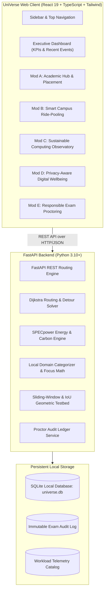

# UniVerse: An Intelligent, Sustainable, and Privacy-Aware Campus Ecosystem

> **Enterprise Campus Operating System & Modern Operations Dashboard**  
> UniVerse brings career readiness, campus carpooling, datacenter energy tracking, digital focus wellbeing, and ethical exam monitoring into one unified, clean, high-density dashboard.

---

## 1. What is UniVerse?

In most universities today, digital services are broken into separate, disconnected tools:
* Students track interview preparation and placement tasks in scattered notes or spreadsheets.
* Campus commuting relies heavily on single-occupancy vehicles, increasing traffic and carbon emissions without safe carpooling options.
* Campus computer labs and servers run workloads 24/7 with zero visibility into power consumption or carbon footprint.
* Digital wellbeing tools either don't exist or spy on students by logging every private website and keystroke.
* Online exam monitoring tools use punitive "black-box" AI that automatically fails students for harmless head turns or bad room lighting.

**UniVerse solves this by uniting five core campus operations into one single, privacy-first, light-theme enterprise dashboard.**

---

## 2. Core System Architecture

UniVerse follows a clean client-server architecture with an isolated local database and distinct operational boundaries:



### Operational Boundary Separation (GHG Protocol Guarantee)
To guarantee 100% scientific honesty, UniVerse strictly separates emissions:
* **Scope 2 Emissions**: Campus server datacenter electricity consumption (measured in kilowatt-hours, kWh).
* **Scope 3 Emissions**: Commuter vehicle tailpipe emissions from carpooling (measured in avoided vehicle-kilometres, VKT).
* **Zero Double-Counting**: Datacenter compute savings and commuter travel savings are never merged into a false "net-zero" number.

---

## 3. Technology Stack

| Layer | Technology | Version | Purpose in UniVerse |
| :--- | :--- | :--- | :--- |
| **Frontend Framework** | React | 19.x | Declarative UI, reactive state, and modular views |
| **Language (Frontend)** | TypeScript | 5.x | Strict type safety matching backend API schemas |
| **Styling & Theme** | Tailwind CSS | 3.4.x | Professional, light enterprise design tokens (#FFFFFF, #F8FAFC) |
| **Icons** | Lucide React | 1.x | Crisp, clean outline SVG icons (zero cartoon emojis) |
| **Build Tool** | Vite | 8.x | Lightning-fast development server with Hot Module Replacement |
| **Backend Framework** | FastAPI | 0.110+ | High-performance asynchronous Python REST API server |
| **Language (Backend)** | Python | 3.10+ | Graph algorithms, energy equations, and test suites |
| **Database** | SQLite3 | 3.x | Zero-configuration local database with ACID transactions |
| **Web Server (ASGI)** | Uvicorn | 0.28+ | Asynchronous ASGI server for production-grade throughput |
| **Testing Harness** | Pytest + AnyIO | 9.x | 62 unit and integration tests with automated execution |

---

## 4. Complete Project Directory Structure

```text
UniVerse/
├── README.md                      # Project documentation and complete startup guide
├── DESIGN.md                      # UI tokens, color palette (#F8FAFC, #FFFFFF), and styling rules
├── PROJECT_PLAN.md                # 7-phase implementation milestones and architectural roadmap
│
├── backend/                       # Python FastAPI Backend
│   ├── main.py                    # Application entry point, CORS config, router registration
│   ├── database.py                # SQLite table schemas, connection pool, initial setup
│   ├── seed.py                    # Idempotent database seeding (mentors, tasks, rides, campus nodes)
│   ├── models.py                  # Pydantic v2 data models, validation schemas, response models
│   ├── graph.py                   # Campus road graph (12 nodes, 20 edges) & Dijkstra shortest path
│   ├── matcher.py                 # Ride-pooling 4-way stop insertion, detour filter, carbon savings
│   ├── energy_model.py            # SPECpower linear server energy equations & CEA grid factor
│   ├── workloads.py               # Seeded telemetry catalog for 3 campus microservices
│   ├── wellbeing.py               # Domain normalization, pause-excluding focus timer, 300s dwell cap
│   ├── exam_rules.py              # Pure algorithmic rules: sliding-window clustering & 2D box IoU
│   ├── requirements.txt           # Python dependencies (fastapi, uvicorn, pydantic, pytest)
│   │
│   ├── routers/                   # Modular REST API Route Handlers
│   │   ├── academic.py            # Placement readiness tasks, mentors, resources, downloads
│   │   ├── rides.py               # Driver rides, passenger search, ride matching, booking
│   │   ├── observatory.py         # Microservice workloads, energy estimates, Scope 2 vs 3
│   │   ├── wellbeing.py           # Voluntary focus sessions, domain evaluation, data purge
│   │   ├── exam.py                # Incident review queue, proctor audit trail, rule testbed
│   │   └── activities.py          # Shared campus notification feed and event logger
│   │
│   └── tests/ (Pytest Suite)
│       ├── test_academic.py       # Unit tests for placement progress & mentor deduplication
│       ├── test_ride_pooling.py   # Unit tests for Dijkstra, unreachable nodes, detour ranking
│       ├── test_observatory.py    # Unit tests for SPECpower math, zero-baseline safety, CEA factor
│       ├── test_wellbeing.py      # Unit tests for focus timers, dwell cap, client data purge
│       ├── test_exam.py           # Unit tests for sliding window, IoU box overlap, audit logging
│       └── test_integration.py    # End-to-end integration tests connecting multiple modules
│
├── frontend/                      # React 19 + TypeScript + Vite Application
│   ├── package.json               # Node.js dependencies, scripts (dev, build, preview)
│   ├── vite.config.ts             # Vite configuration with React plugin
│   ├── tailwind.config.js         # Custom enterprise color palette, font sizes, border radii
│   ├── tsconfig.json              # Strict TypeScript compiler options
│   │
│   └── src/                       # Source Code
│       ├── main.tsx               # Client entry point mounting React root
│       ├── App.tsx                # Top-level shell connecting Sidebar, Header, and Views
│       ├── index.css              # Tailwind CSS directives and global typography
│       │
│       ├── types/                 # TypeScript Interface Definitions
│       │   ├── navigation.ts      # Active modules, user persona roles, activity alerts
│       │   ├── academic.ts        # Placement tasks, student profiles, mentors, resources
│       │   ├── rides.ts           # Campus nodes, driver offers, match results, savings summary
│       │   ├── observatory.ts     # Workload telemetry, scenario evaluations, Scope 2 vs 3
│       │   ├── wellbeing.ts       # Focus timer states, domain rules, browsing metrics
│       │   └── exam.ts            # Incidents, review statuses, audit log entries, bounding boxes
│       │
│       ├── services/              # Dual-Mode API Client Services (Backend + Fallbacks)
│       │   ├── academicApi.ts     # Academic hub REST calls with in-memory fallback
│       │   ├── ridesApi.ts        # Ride-pooling REST calls with graph fallback
│       │   ├── observatoryApi.ts  # Energy observatory REST calls with SPECpower fallback
│       │   ├── wellbeingApi.ts    # Digital wellbeing client storage & evaluation
│       │   └── examApi.ts         # Exam proctoring queue & audit log client
│       │
│       └── components/            # High-Density UI Components
│           ├── layout/
│           │   ├── Sidebar.tsx    # Left sidebar with logo, active pills, persona switcher
│           │   └── Header.tsx     # Canvas header with term selector, filter, export, avatar
│           ├── dashboard/
│           │   ├── OverviewView.tsx # Executive dashboard matching reference design
│           │   └── MetricCard.tsx # Reusable KPI metric card
│           ├── common/            # Reusable UI Primitives
│           │   ├── Button.tsx     # Standard enterprise buttons (primary, outline, secondary)
│           │   ├── Card.tsx       # White card containers with subtle borders
│           │   ├── StatCard.tsx   # Top-row statistic visualizer with indicator dots
│           │   ├── StatusBadge.tsx# Semantic status badges (Approved, Eco, Review, Dismissed)
│           │   ├── NotificationDrawer.tsx # Slide-out campus activity drawer
│           │   └── PageHeader.tsx # Standardized module header with action slots
│           ├── academic/          # Module A Components
│           │   ├── AcademicHubView.tsx
│           │   ├── PlacementReadinessView.tsx
│           │   ├── MentorDirectoryView.tsx
│           │   └── AcademicResourceView.tsx
│           ├── rides/             # Module B Components
│           │   ├── RidePoolingView.tsx
│           │   ├── CampusGraphMap.tsx
│           │   ├── DriverRidesSection.tsx
│           │   ├── PassengerSearchSection.tsx
│           │   └── TransportSavingsSummaryCard.tsx
│           ├── observatory/       # Module C Components
│           │   ├── ObservatoryView.tsx
│           │   ├── TelemetryServiceCards.tsx
│           │   ├── ScenarioComparisonView.tsx
│           │   ├── ConfigurableAssumptionsCard.tsx
│           │   └── TransportVsComputeCard.tsx
│           ├── wellbeing/         # Module D Components
│           │   ├── WellbeingView.tsx
│           │   ├── FocusTimerCard.tsx
│           │   ├── BrowsingInspectorCard.tsx
│           │   ├── MetricsSummaryCard.tsx
│           │   └── DataSovereigntyCard.tsx
│           └── exam/              # Module E Components
│               ├── ExamMonitoringView.tsx
│               ├── ExamProctorBanner.tsx
│               ├── IncidentReviewTable.tsx
│               ├── IncidentDetailPanel.tsx
│               ├── ControlledCameraFeed.tsx
│               └── ObservableRulesVisualizer.tsx
│
└── docs/                          # Detailed Technical Documentation & Viva Guides
    ├── SYSTEM_ARCHITECTURE.md     # Architecture specifications and component interactions
    ├── ALGORITHMS.md              # Mathematical derivations, pseudocode, time complexities
    ├── ALGORITHMIC_DECISIONS.md   # Architectural trade-offs and design justifications
    ├── API_DOCUMENTATION.md       # Complete OpenAPI endpoint reference and JSON payloads
    ├── DATABASE_SCHEMA.md         # Database tables, foreign keys, and indexes
    ├── TESTING_REPORT.md          # Complete test execution logs and verification proofs
    ├── TEST_SCENARIOS.md          # 10 comprehensive evaluation scenarios
    ├── PRIVACY_AND_RESPONSIBLE_AI.md # Ethical safeguards, non-punitive policies
    ├── AI_USAGE.md                # Transparent disclosure of AI design tools
    ├── DEMO_SCRIPT.md             # Step-by-step evaluation presentation script
    └── FINAL_SUBMISSION_CHECKLIST.md # Submission verification checklist
```

---

## 5. Five Integrated Modules & Algorithmic Foundations

### Module A: Student Intelligence & Academic Hub
* **Placement Readiness Index**: Categorizes interview prep into 5 pillars: DSA, Development, CS Fundamentals, Aptitude, and Interview Prep. Calculates exact percentage readiness based on completed milestones.
* **Peer Mentorship Network**: Connects students with experienced seniors. Enforces a database rule to prevent duplicate pending requests to the same mentor.
* **Academic Resource Repository**: Searchable, tag-filtered collection of lecture notes, question papers (PYQs), and lab guides with download tracking.

### Module B: Smart Campus Ride-Pooling
* **Dijkstra Shortest Path Engine**: Campus road network modeled as 12 landmarks with 20 road segments. Min-heap priority queue ($O((V + E) \log V)$) finds optimal distance and reconstructs the road path.
* **Sequential 4-Stop Insertion**: Driver route ($\text{Origin} \to \text{Destination}$) is tested with passenger stops ($\text{Origin} \to \text{Pickup} \to \text{Drop} \to \text{Destination}$). Calculates detour:
  $$\text{Detour}_{\text{km}} = \max\left(0, \text{Shared Distance} - \text{Driver Direct Distance}\right)$$
* **Deterministic Matching & Ranking**: Filters by seat count, schedule window, and maximum allowed detour. Returns human-readable rejection reasons when a ride does not match.
* **Avoided Kilometres & Carbon Offset**: Calculates vehicle-kilometres saved:
  $$\text{Saved Distance} = (\text{Driver Direct} + \text{Passenger Direct}) - \text{Shared Distance}$$
  Evaluated at ₹8.50/km fuel cost and 120 g CO₂e/km (EPA passenger car standard).

### Module C: Sustainable Computing Observatory
* **SPECpower Linear Energy Model**: Uses server idle power ($P_{\text{idle}} = 45\text{ W}$) and peak power ($P_{\text{max}} = 220\text{ W}$):
  $$P_{\text{avg}} = P_{\text{idle}} + (P_{\text{max}} - P_{\text{idle}}) \times u \quad (u = \text{CPU utilization fraction})$$
* **Kilowatt-Hour Conversion**:
  $$E_{\text{kWh}} = \frac{P_{\text{avg}} \times \text{Duration in seconds}}{3{,}600{,}000}$$
* **Grid Carbon Emissions**:
  $$\text{CO}_2\text{ (kg)} = E_{\text{kWh}} \times f_{\text{grid}}$$
  Default grid factor $f_{\text{grid}} = 0.716\text{ kg CO}_2/\text{kWh}$, cited directly from India's **Central Electricity Authority (CEA) CO2 Baseline Database v19.0 (2024)**.
* **Workload Comparison**: Side-by-side comparison of baseline vs. eco-optimized telemetry across three microservices (Placement API, Resource Search, Ride Matcher).

### Module D: Privacy-Aware Digital Wellbeing
* **Drift-Free Wall-Clock Timer**: Stores true Unix epoch timestamps so the focus timer never freezes or drifts when browser tabs sleep:
  $$T_{\text{effective}} = (T_{\text{stop}} - T_{\text{start}}) - \sum T_{\text{paused}}$$
* **Zero-Surveillance Architecture**: Never logs raw URLs, search terms, page contents, or keystrokes. Only base hostnames are normalized locally.
* **Capped Dwell Time**: Transitions between domain categories count context switches. Inactivity gaps are capped at 300 seconds (5 minutes) to avoid falsely logging hours of distraction when the student stepped away.
* **Full Data Sovereignty**: One-click "Inspect Raw Data" modal and permanent SQLite deletion button.

### Module E: Responsible Examination Monitoring
* **Non-Punitive Ethical AI**: Automated computer vision detections are strictly treated as **preliminary behavioral cues for human invigilator review**, NEVER proof of academic misconduct. Automated punishments are strictly forbidden.
* **Observable Event Rules** (tested independently of cameras):
  - *Rule 1 (Temporal Clustering)*: Triggers when $\ge 3$ head-turn events occur within any 30-second sliding window.
  - *Rule 2 (Cartesian 2D Bounding Box Intrusion)*: Calculates geometric overlap (Intersection over Union, IoU) between student position and restricted desk zones.
* **Certified Proctor Review Queue**: Human workflow (`Pending Review` $\to$ `In Review` $\to$ `Dismissed as False Positive` or `Resolved`).
* **Immutable Audit Trail**: Every status change, proctor name, and evaluation note is permanently saved to an immutable audit ledger (`exam_audit_log`).
* **Zero Cloud Storage**: Video feeds are processed locally in volatile browser memory; no video clips or facial biometric embeddings are ever stored or uploaded.

---

## 6. Fast-Track Setup Guide: From Clone to Run

### Option A: Run Everything at Once (Windows PowerShell)

Open PowerShell and copy-paste this complete block:

```powershell
# 1. Clone repository & enter project directory
git clone https://github.com/laukik-26/UniVerse.git
cd UniVerse

# 2. Setup and launch Backend in background
cd backend
python -m venv .venv
.\.venv\Scripts\Activate.ps1
pip install -r requirements.txt
python database.py
python seed.py
Start-Process powershell -ArgumentList "-NoExit", "-Command", "cd '$PWD'; .\.venv\Scripts\Activate.ps1; python -m uvicorn main:app --port 8000 --reload"

# 3. Setup and launch Frontend in background
cd ..\frontend
npm install
Start-Process powershell -ArgumentList "-NoExit", "-Command", "cd '$PWD'; npm run dev"

# 4. Open browser
Start-Process "http://localhost:5173"
```

---

### Option B: Step-by-Step Manual Setup

#### Step 1: Clone the Repository
```bash
git clone https://github.com/laukik-26/UniVerse.git
cd UniVerse
```

#### Step 2: Start the Backend API Server
Open a terminal in the `backend/` directory:
```bash
cd backend

# Create and activate virtual environment
python -m venv .venv

# Windows:
.\.venv\Scripts\Activate.ps1
# macOS/Linux:
# source .venv/bin/activate

# Install dependencies
pip install -r requirements.txt

# Initialize database and seed initial data
python database.py
python seed.py

# Start FastAPI server
python -m uvicorn main:app --host 127.0.0.1 --port 8000 --reload
```
* **Backend API Docs**: [http://localhost:8000/docs](http://localhost:8000/docs)
* **Backend Health Check**: [http://localhost:8000/api/health](http://localhost:8000/api/health)

#### Step 3: Start the Frontend Application
Open a **second** terminal in the `frontend/` directory:
```bash
cd frontend

# Install dependencies
npm install

# Start Vite development server
npm run dev
```
* **Frontend Dashboard**: [http://localhost:5173](http://localhost:5173)

---

## 7. Running the Automated Test Suites

### Backend Unit & Integration Tests (62 Tests)
From the `backend/` folder:
```bash
python -m pytest -v
```
All **62 tests pass** in ~1.2 seconds, covering:
- Placement task progress and mentor deduplication.
- Dijkstra shortest path calculations and detour rejections.
- SPECpower energy conversions and zero-baseline division protection.
- Digital wellbeing pause-excluding timers, dwell time capping, and data purge.
- Exam sliding-window frequency rules and bounding-box IoU geometry.
- End-to-end integration workflows.

### Frontend TypeScript Verification & Build Check
From the `frontend/` folder:
```bash
npm run build
```
Validates all TypeScript interfaces, component props, and bundles production assets with **0 errors**.

---

## 8. Interactive Persona Switcher

UniVerse includes an in-app persona switcher in the bottom-left sidebar so evaluators can inspect the dashboard from 5 distinct stakeholder perspectives:
1. **Student (Alex Rivera)**: Manages placement goals, books campus rides, uses focus timer, view exam station.
2. **Peer Mentor (Sarah Lin)**: Accepts and declines incoming mentorship requests.
3. **Transit Coordinator (Marcus Vance)**: Publishes new carpool routes and monitors vehicle-km saved.
4. **Green IT Analyst (Dr. Elena Rostova)**: Evaluates microservice power draw, adjusts grid emissions factors, and inspects Scope 2 vs 3 separation.
5. **Exam Proctor (Prof. David Kelling)**: Reviews flagged exam cues, inspects camera feeds, adds evaluation notes, and writes to the immutable audit log.

---

## 9. Comprehensive Documentation Index

Deep-dive documentation is available in the [`docs/`](docs/) directory:
* [docs/SYSTEM_ARCHITECTURE.md](docs/SYSTEM_ARCHITECTURE.md) — System architecture, data flow, and complete Mermaid diagrams.
* [docs/ALGORITHMS.md](docs/ALGORITHMS.md) — Mathematical derivations, formulas, pseudocode, and time complexities.
* [docs/ALGORITHMIC_DECISIONS.md](docs/ALGORITHMIC_DECISIONS.md) — Architectural trade-offs and student viva guide.
* [docs/API_DOCUMENTATION.md](docs/API_DOCUMENTATION.md) — Complete OpenAPI catalog, request/response bodies, and error codes.
* [docs/DATABASE_SCHEMA.md](docs/DATABASE_SCHEMA.md) — SQLite table schemas, data types, indexes, and privacy rules.
* [docs/TESTING_REPORT.md](docs/TESTING_REPORT.md) — Full automated test reports and verification logs.
* [docs/TEST_SCENARIOS.md](docs/TEST_SCENARIOS.md) — 10 step-by-step evaluation scenarios across all modules.
* [docs/PRIVACY_AND_RESPONSIBLE_AI.md](docs/PRIVACY_AND_RESPONSIBLE_AI.md) — Ethical AI policies, data minimization, and audit trail guarantees.
* [docs/DEMO_SCRIPT.md](docs/DEMO_SCRIPT.md) — Step-by-step 4–5 minute presentation guide.
* [docs/FINAL_SUBMISSION_CHECKLIST.md](docs/FINAL_SUBMISSION_CHECKLIST.md) — Final evaluation verification checklist.
