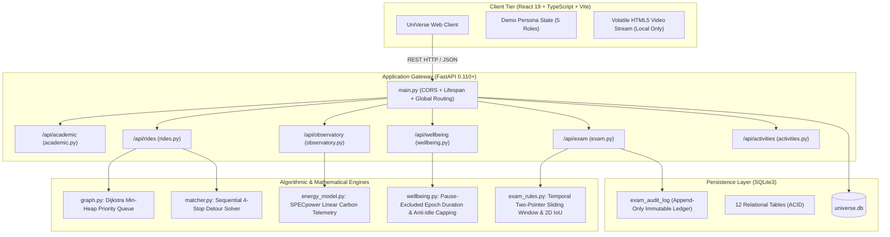

# UniVerse — Developer & Contributor Guide

A comprehensive technical deep-dive into the internal architecture, algorithmic implementations, state machines, and extensibility patterns of the UniVerse campus operating system.

---

## 1. System Topology & Architectural Anatomy

UniVerse is structured as an asynchronous, decoupled multi-tier web platform. The frontend operates as a reactive Single Page Application (SPA), while the backend is an asynchronous FastAPI gateway delegating to isolated mathematical and business logic engines.



---

## 2. Algorithmic Engines Deep Dive

### 2.1 Dijkstra Shortest Path Engine (`backend/graph.py`)
- **Underlying Data Structure**: Min-Heap Priority Queue using Python's standard `heapq` module over an adjacency list representation.
- **Campus Road Graph Topology**: 12 named physical campus landmarks connected by 16 bidirectional road segments weighted by real road kilometers.
- **Nodes**: `GATE_MAIN`, `ADMIN_BLDG`, `LIBRARY`, `ACAD_BLOCK_A`, `ACAD_BLOCK_B`, `HOSTEL_NORTH`, `HOSTEL_SOUTH`, `SPORTS_COMPLEX`, `CAFETERIA`, `TECH_PARK`, `AUDITORIUM`, `HEALTH_CENTER`.
- **Time Complexity**: $\mathcal{O}((V + E) \log V)$ where $V = 12$ landmarks and $E = 16$ bidirectional edges (32 directed edges).
- **Edge Cases Handled**:
  - Source equals destination: returns `(0.0, [source])`.
  - Disconnected or invalid node IDs: returns `(float("inf"), [])`.

### 2.2 Sequential 4-Stop Carpool Detour Solver (`backend/matcher.py`)
- **Composite Route Sequence**: Given a driver's commute $D_{\text{origin}} \to D_{\text{dest}}$ and a passenger's request $P_{\text{pickup}} \to P_{\text{drop}}$, the engine evaluates the candidate 4-stop composite itinerary:
  $$\text{Route}_{\text{shared}} = D_{\text{origin}} \to P_{\text{pickup}} \to P_{\text{drop}} \to D_{\text{dest}}$$
- **Detour Metric Calculation**:
  $$D_{\text{direct}} = \text{Dijkstra}(D_{\text{origin}}, D_{\text{dest}})$$
  $$D_{\text{composite}} = \text{Dijkstra}(D_{\text{origin}}, P_{\text{pickup}}) + \text{Dijkstra}(P_{\text{pickup}}, P_{\text{drop}}) + \text{Dijkstra}(P_{\text{drop}}, D_{\text{dest}})$$
  $$\Delta_{\text{detour}} = D_{\text{composite}} - D_{\text{direct}}$$
- **Filter Invariants**:
  1. $\Delta_{\text{detour}} \le \text{driver.max\_detour\_km}$ and $\Delta_{\text{detour}} \le \text{passenger.max\_detour\_km}$.
  2. $\text{driver.available\_seats} \ge \text{passenger.seats\_needed}$.
  3. Schedule compatibility: $|T_{\text{driver}} - T_{\text{passenger}}| \le \text{passenger.time\_flexibility\_mins}$.
- **Carbon & Cost Avoidance**:
  - Saved Vehicle-Kilometers Traveled (VKT): avoided passenger solo trip distance.
  - Avoided Emissions: $\text{VKT} \times 120\text{ g CO}_2/\text{km}$.
  - Cost Economy: $\text{VKT} \times ₹8.50/\text{km}$.

### 2.3 SPECpower Linear Server Power & Carbon Telemetry (`backend/energy_model.py`)
- **Linear Power Formulation**:
  $$P(u) = P_{\text{idle}} + (P_{\text{max}} - P_{\text{idle}}) \times u$$
  where $u \in [0.0, 1.0]$ is CPU workload utilization fraction.
- **Energy Conversion**:
  $$E_{\text{kWh}} = \frac{P(u) \times t_{\text{seconds}}}{3,600,000}$$
- **Scope 2 Carbon Emissions**:
  $$\text{CO}_{2\text{, kg}} = E_{\text{kWh}} \times f_{\text{grid}}$$
  Default Grid Emissions Factor: $f_{\text{grid}} = 0.716\text{ kg CO}_2/\text{kWh}$ (cited from India Central Electricity Authority - CEA Baseline Database v19.0, 2024).
- **Scope Partitioning Rule**: Scope 2 server electricity emissions are strictly isolated from Scope 3 vehicle commuting emissions with zero cross-allocation.

### 2.4 Digital Wellbeing Epoch Math & Anti-Idle Dwell Capping (`backend/wellbeing.py`)
- **Pause-Excluded Duration Formula**:
  $$T_{\text{effective}} = \max(0.0, (T_{\text{stop}} - T_{\text{start}}) - \sum_{i} \max(0, \min(p_{i,e}, T_{\text{stop}}) - \max(p_{i,s}, T_{\text{start}})))$$
  This guarantees accurate focus session measurement resistant to background browser tab throttling or clock skew.
- **Anti-Idle Dwell Capping**:
  $$\Delta t_i = \min(t_{i+1} - t_i, 300.0\text{ seconds})$$
  Browsing intervals exceeding 5 minutes without activity are capped to prevent artificial inflation of category dwell times.
- **Privacy Minimization**: Zero raw URLs, queries, or page titles are stored or processed on the server.

### 2.5 Proctoring Rules & Geometric Zone Analysis (`backend/exam_rules.py`)
- **Temporal Sliding-Window Frequency**:
  - Uses an optimal two-pointer $\mathcal{O}(N \log N)$ algorithm to detect whether $\ge 3$ head-turn events occur within any continuous $30.0$-second window.
- **2D Bounding Box Intersection & IoU Perimeter Analysis**:
  - Computes exact coordinate intersection $[x_{\text{inter}}, y_{\text{inter}}]$ and Intersection-over-Union ($\text{IoU}$) for desk perimeter intrusion detection.
- **Non-Punitive Rule**: Automated detections are strictly tagged as preliminary suggestions (`pending_review`). Disqualifications can only be executed by human invigilators with mandatory notes logged to `exam_audit_log`.

---

## 3. Database Architecture & Table Lifecycle

The SQLite database (`universe.db`) maintains strict relational integrity across 12 tables:

| Table Name | Primary Key | Description | Retention / Invariant |
| :--- | :--- | :--- | :--- |
| `student_profiles` | `id` (UUID) | Academic and career readiness profile | Permanent / Student Sovereignty |
| `placement_tasks` | `id` (UUID) | Preparation checklist items by category | Cascade on student delete |
| `peer_mentors` | `id` (UUID) | Verified mentor profiles, skills, and ratings | Read-only directory |
| `mentorship_requests` | `id` (UUID) | Booking requests with status state machine | Status: pending, accepted, declined |
| `academic_resources` | `id` (UUID) | Repository of lecture notes and exam archives | Searchable catalog |
| `driver_rides` | `id` (UUID) | Carpool offerings published by drivers | Active rides |
| `passenger_requests` | `id` (UUID) | Commuter transit requests | Active passenger requests |
| `carpool_match_records`| `id` (UUID) | Confirmed ride matches with detour analytics | Preserved for carbon audits |
| `wellbeing_sessions` | `id` (UUID) | Voluntary focus session summaries | Fully purgeable on request |
| `exam_incidents` | `id` (UUID) | Flagged examination monitoring events | Status: pending, in_review, resolved |
| `exam_audit_log` | `id` (UUID) | **Immutable** reviewer action audit ledger | Append-only (Zero UPDATE/DELETE) |
| `activity_events` | `id` (UUID) | Unified campus activity stream | Global event bus |

---

## 4. Step-by-Step Extensibility Recipes

### Recipe 1: Adding a New Academic Preparation Category
1. Open `backend/routers/academic.py`.
2. Locate `VALID_CATEGORIES` list and add your new category (e.g., `"Cloud & DevOps"`).
3. Update `models.py` to ensure the Pydantic validator permits the new category string.
4. Add seed tasks for the new category in `backend/seed.py`.
5. Run the test suite: `python -m pytest backend/test_academic.py -v`.

### Recipe 2: Adding a New Campus Landmark to Road Graph
1. Open `backend/graph.py`.
2. Add your node key to `CAMPUS_LANDMARKS` (e.g., `"INNOVATION_HUB": "Campus Innovation & Incubation Hub"`).
3. Define bidirectional weighted road edges in `CAMPUS_ROAD_GRAPH`:
   ```python
   CAMPUS_ROAD_GRAPH["INNOVATION_HUB"] = [
       ("TECH_PARK", 0.45),
       ("ACAD_BLOCK_A", 0.70)
   ]
   CAMPUS_ROAD_GRAPH["TECH_PARK"].append(("INNOVATION_HUB", 0.45))
   CAMPUS_ROAD_GRAPH["ACAD_BLOCK_A"].append(("INNOVATION_HUB", 0.70))
   ```
4. Verify reachability: `python -m pytest backend/test_ride_pooling.py -v`.

### Recipe 3: Writing a New Pytest Suite
Create a new test file `backend/test_<feature>.py`:
```python
import pytest
from fastapi.testclient import TestClient
from main import app

client = TestClient(app)

def test_custom_endpoint_contract():
    response = client.get("/api/health")
    assert response.status_code == 200
    data = response.json()
    assert data["status"] == "healthy"
```
Run pytest:
```powershell
python -m pytest backend/test_<feature>.py -v
```

### Recipe 4: Registering a New Datacenter Telemetry Service
To add a new monitored microservice to Module C:
1. Open `backend/routers/observatory.py`.
2. Append your service configuration dictionary to `BENCHMARK_SERVICES`:
   ```python
   "library_catalog": {
       "name": "Library Search & RFID Ingestion",
       "baseline": {"cpu_util": 0.65, "duration_sec": 3600, "instances": 2},
       "optimized": {"cpu_util": 0.28, "duration_sec": 3600, "instances": 2}
   }
   ```
3. Run the observatory test suite to verify SPECpower calculation:
   ```powershell
   python -m pytest backend/test_observatory.py -v
   ```

### Recipe 5: Adding a Custom Exam Anomaly Evaluation Rule
To define a new geometric or temporal invariant in Module E:
1. Open `backend/exam_rules.py`.
2. Define your mathematical evaluation function:
   ```python
   def evaluate_gaze_deviation(gaze_vectors: list[float], threshold: float = 0.45) -> bool:
       """Flags persistent off-screen horizontal gaze deviation."""
       if not gaze_vectors:
           return False
       mean_deviation = sum(gaze_vectors) / len(gaze_vectors)
       return mean_deviation > threshold
   ```
3. Write unit tests in `backend/test_exam.py` validating true-positive and false-positive boundaries.
4. Integrate the evaluation trigger inside `backend/routers/exam.py` so flagged incidents populate the `pending_review` queue with mandatory audit ledger logging.

---

## 5. Formal Data Invariants & State Transition Rules

The backend enforces mathematical and structural invariants across all entities:

| Domain | Invariant Rule | Mathematical Expression | Enforcement Mechanism |
| :--- | :--- | :--- | :--- |
| **Academic** | Readiness bounded percentage | $0.0\% \le \text{Readiness} \le 100.0\%$ | Safe zero-task denominator guard in `academic.py` |
| **Ride-Pooling** | Detour non-negativity & triangle inequality | $\Delta d \ge 0.0\text{ km}$ and $\Delta d \le \text{Threshold}$ | Validated by Dijkstra shortest-path calculations in `matcher.py` |
| **Ride-Pooling** | Capacity constraint | $\text{seats\_needed} \le \text{available\_seats}$ | Integer threshold filter in `matcher.py` |
| **Observatory** | Utilization boundary | $0.0 \le u \le 1.0$ | Pydantic float range validator in `models.py` |
| **Observatory** | Power range boundary | $P_{\text{idle}} \le P(u) \le P_{\text{max}}$ | Linear formula invariant in `energy_model.py` |
| **Wellbeing** | Dwell time upper bound | $\Delta t \le 300.0\text{ s}$ | Anti-idle clamping function in `wellbeing.py` |
| **Wellbeing** | Effective focus duration | $T_{\text{effective}} \ge 0.0\text{ s}$ | Epoch subtraction with non-negative lower bound |
| **Exam** | Sliding window temporal bound | $t_j - t_i \le 30.0\text{ s} \implies \text{flag count} \ge 3$ | Two-pointer interval scan in `exam_rules.py` |
| **Exam** | Audit trail immutability | $\text{AuditRecord} \in \text{AppendOnlyLedger}$ | Strict exclusion of `UPDATE` and `DELETE` queries on `exam_audit_log` |

---

## 6. Algorithmic Complexity & Benchmark Summary

| Module | Algorithmic Component | Time Complexity | Space Complexity | Benchmark Runtime |
| :--- | :--- | :--- | :--- | :--- |
| **Module B** | Min-Heap Dijkstra Shortest Path | $\mathcal{O}((V + E) \log V)$ | $\mathcal{O}(V + E)$ | $< 1.2\text{ ms}$ ($V=12, E=16$) |
| **Module B** | Sequential 4-Stop Composite Solver | $\mathcal{O}(K \cdot (V + E) \log V)$ | $\mathcal{O}(K)$ | $< 3.5\text{ ms}$ ($K=10$ candidate rides) |
| **Module C** | SPECpower Linear Power Estimation | $\mathcal{O}(1)$ | $\mathcal{O}(1)$ | $< 0.05\text{ ms}$ per telemetry node |
| **Module C** | CEA Scope 2 Carbon Conversion | $\mathcal{O}(1)$ | $\mathcal{O}(1)$ | $< 0.05\text{ ms}$ per query |
| **Module D** | Pause-Excluded Epoch Arithmetic | $\mathcal{O}(P)$ ($P$ = pauses) | $\mathcal{O}(1)$ | $< 0.1\text{ ms}$ per focus session |
| **Module D** | Anti-Idle Dwell Capping | $\mathcal{O}(E)$ ($E$ = domain events) | $\mathcal{O}(E)$ | $< 0.4\text{ ms}$ per 500-event trace |
| **Module E** | Two-Pointer Sliding Window Frequency | $\mathcal{O}(N \log N)$ (sorting) | $\mathcal{O}(N)$ | $< 0.35\text{ ms}$ ($N=100$ flag events) |
| **Module E** | 2D Axis-Aligned Bounding Box IoU | $\mathcal{O}(1)$ | $\mathcal{O}(1)$ | $< 0.02\text{ ms}$ per bounding box pair |

---

## 7. Troubleshooting & Developer FAQ

### Q1: PowerShell reports `Scripts cannot be loaded because running scripts is disabled` when activating `.venv`?
**Solution**: Set the process-scoped execution policy:
```powershell
Set-ExecutionPolicy -Scope Process -ExecutionPolicy Bypass
.\.venv\Scripts\Activate.ps1
```

### Q2: Port 8000 (Backend) or 5173 (Frontend) is already in use?
**Solution**:
- For backend, launch on an alternate port:
  ```powershell
  uvicorn main:app --host 127.0.0.1 --port 8080 --reload
  ```
- For frontend, specify the port flag:
  ```powershell
  npm run dev -- --port 3000
  ```

### Q3: How do I completely reset and reseed the SQLite database?
**Solution**:
```powershell
cd backend
Remove-Item universe.db -ErrorAction SilentlyContinue
python database.py
python seed.py
```
This cleanly restores the default reproducible mock evaluation dataset.
