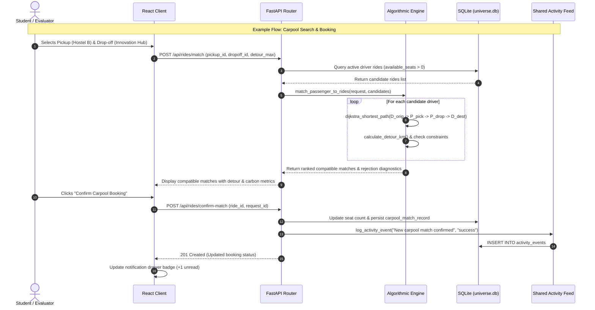
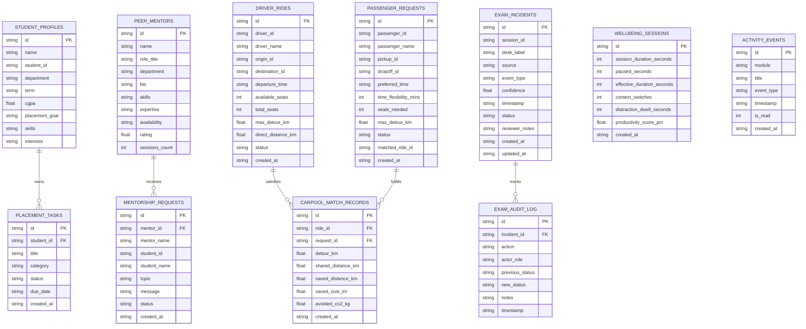

# UniVerse — System Architecture & Component Design

## 1. Architectural Overview
UniVerse is engineered as a decoupled, multi-tier web platform designed for modularity, low operational latency, and privacy by architecture. The platform consists of a modern Single Page Application (SPA) frontend, an asynchronous FastAPI REST backend, and a local SQLite3 persistence engine with dedicated algorithmic computational layers.

```mermaid
graph TD
    subgraph ClientLayer ["Client Presentation Tier (Browser)"]
        UI["React 19 + TypeScript SPA"]
        NAV["Enterprise Sidebar & Header (56px)"]
        MOD_A_UI["Academic Hub View"]
        MOD_B_UI["Ride-Pooling View & Map"]
        MOD_C_UI["Eco Observatory View"]
        MOD_D_UI["Digital Wellbeing View"]
        MOD_E_UI["Exam Proctoring View"]
        CAM["HTML5 WebCam Element (Local volatile buffer)"]
    end

    subgraph APILayer ["Backend Application Tier (FastAPI + Uvicorn)"]
        MAIN["FastAPI Gateway (main.py)"]
        CORS["CORS & Lifespan Initializer"]
        
        ROUTER_A["academic.py"]
        ROUTER_B["rides.py"]
        ROUTER_C["observatory.py"]
        ROUTER_D["wellbeing.py"]
        ROUTER_E["exam.py"]
        ROUTER_ACT["activities.py"]
    end

    subgraph LogicLayer ["Algorithmic Engines & Business Logic"]
        GRAPH_ENG["graph.py: Dijkstra Shortest Path Engine"]
        MATCH_ENG["matcher.py: 4-Stop Insertion & Detour Optimizer"]
        ENERGY_ENG["energy_model.py: SPECpower Linear Carbon Estimator"]
        WELL_ENG["wellbeing.py: Domain Normalization & Epoch Math"]
        EXAM_ENG["exam_rules.py: Sliding Window & IoU Intrusion Engine"]
    end

    subgraph DataLayer ["Persistence Tier (SQLite Local)"]
        DB[(universe.db)]
        T_ACAD["student_profiles, placement_tasks, peer_mentors, mentorship_requests, academic_resources"]
        T_RIDES["driver_rides, passenger_requests, carpool_match_records"]
        T_WELL["wellbeing_sessions (Aggregates only)"]
        T_EXAM["exam_incidents, exam_audit_log (Immutable)"]
        T_ACT["activity_events (Shared Activity Ledger)"]
    end

    UI --> MAIN
    CAM -.->|Local feed only| MOD_E_UI
    
    MAIN --> CORS
    CORS --> ROUTER_A
    CORS --> ROUTER_B
    CORS --> ROUTER_C
    CORS --> ROUTER_D
    CORS --> ROUTER_E
    CORS --> ROUTER_ACT

    ROUTER_A --> T_ACAD
    ROUTER_B --> GRAPH_ENG
    ROUTER_B --> MATCH_ENG
    ROUTER_B --> T_RIDES
    ROUTER_C --> ENERGY_ENG
    ROUTER_D --> WELL_ENG
    ROUTER_D --> T_WELL
    ROUTER_E --> EXAM_ENG
    ROUTER_E --> T_EXAM

    ROUTER_A -.->|Logs activity| ROUTER_ACT
    ROUTER_B -.->|Logs activity| ROUTER_ACT
    ROUTER_C -.->|Logs activity| ROUTER_ACT
    ROUTER_D -.->|Logs aggregate session| ROUTER_ACT
    ROUTER_E -.->|Logs proctor determination| ROUTER_ACT
    
    ROUTER_ACT --> T_ACT
    T_ACAD --> DB
    T_RIDES --> DB
    T_WELL --> DB
    T_EXAM --> DB
    T_ACT --> DB
```

---

## 2. Component Responsibilities

### 2.1 Client Tier (`frontend/src/`)
- **Application Shell (`App.tsx`, `Sidebar.tsx`, `Header.tsx`)**:
  - Maintains active module view routing without page reloads.
  - Manages authenticated demo persona state (`student`, `peer-mentor`, `transit-coordinator`, `sustainability-analyst`, `exam-proctor`).
  - Provides notification drawer with real-time poll-less event ingestion from backend.
- **Academic Hub (`components/academic/`)**:
  - Manages student placement checklist milestones and category aggregations.
  - Interactive peer mentor booking and request status management.
  - Academic resource library with subject filtering and simulated download counters.
- **Ride-Pooling (`components/rides/`)**:
  - Interactive 2D vector coordinate map of the 12 campus nodes and 16 connecting roads.
  - Driver ride scheduling and passenger search interface with dynamic detour visualization.
- **Sustainable Computing Observatory (`components/observatory/`)**:
  - Visualizes SPECpower workload power curves, Scope 2 vs Scope 3 carbon partitioning, and interactive what-if parameters.
- **Digital Wellbeing (`components/wellbeing/`)**:
  - Self-contained focus timer using browser `Date.now()` epoch arithmetic.
  - Client-side domain classifier and local-only SQLite session history with one-click purge.
- **Responsible Examination Monitoring (`components/exam/`)**:
  - 60/40 Master-detail invigilation queue with instant side-panel review.
  - HTML5 video capture element for local camera checking with volatile in-memory canvas processing (zero frame transmission to server).

### 2.2 Application & Routing Tier (`backend/routers/`)
- **FastAPI Gateway (`main.py`)**:
  - Configures CORS middleware for frontend development servers.
  - Coordinates database schema creation (`init_db`) and deterministic seeding (`seed_database`) on startup.
- **Routers**:
  - `routers/academic.py`: Endpoints for profile retrieval, task CRUD, mentor requests, and resource downloads.
  - `routers/rides.py`: Endpoints for locations, shortest path calculations, driver ride creation, carpool matching, and transport savings.
  - `routers/observatory.py`: Telemetry catalogs, custom power estimates, and scenario comparisons.
  - `routers/wellbeing.py`: Evaluates synthetic browsing events and persists privacy-preserving session aggregates.
  - `routers/exam.py`: Incident queue, proctor determinations, and geometric rule testbeds.
  - `routers/activities.py`: Centralized notification event retrieval and mark-as-read updates.

### 2.3 Algorithmic Computational Engines (`backend/`)
- **`graph.py`**: Builds the static adjacency graph and computes shortest paths via Dijkstra with a binary min-heap (`heapq`).
- **`matcher.py`**: Evaluates 4-stop passenger insertion sequences, calculates detour additions, and deterministically ranks match candidates.
- **`energy_model.py`**: Mathematical linear power equations, kilowatt-hour conversions, and CEA grid carbon multipliers.
- **`wellbeing.py`**: String domain normalization, regex classification, pause interval exclusion, and capped dwell time calculations.
- **`exam_rules.py`**: Sliding-window temporal event counters, 2D Cartesian point-in-box testers, and axis-aligned bounding box IoU calculations.

### 2.4 Persistence Tier (`backend/database.py`)
- SQLite3 database (`universe.db`) with `sqlite3.Row` mapping.
- Implements foreign key references, index constraints, and separate table domains for each module.

---

## 3. Data Flow and Inter-Module Communication

---

## 4. Shared Activity & Notification Architecture

To avoid tightly coupling modules, UniVerse uses an event-sinking architecture:
1. When a meaningful state transition occurs in any module (e.g. mentor accepts request, ride is booked, proctor reviews an incident):
   - The router invokes `log_activity_event(cursor, module, title, event_type)`.
   - The event is appended to the `activity_events` SQLite table with a timestamp, read flag, and severity level (`info`, `success`, `alert`).
2. **Privacy Constraint**:
   - Module D (Digital Wellbeing) **never** logs raw URLs or domain names to the shared feed. It only logs aggregate milestones (e.g., *"Focus Session Logged: 30m effective focus"*).
   - Module E (Exam Monitoring) **never** exposes student identity or speculative misconduct conclusions in the feed. It records objective invigilation milestones (e.g., *"Incident inc-102 reviewed: Marked as Dismissed"*).
3. The frontend `App.tsx` polls `/api/activities` on mount and provides an `onActivityLogged` callback to child modules for instantaneous optimistic updates in the user interface.

---

## 5. Entity-Relationship Data Model

